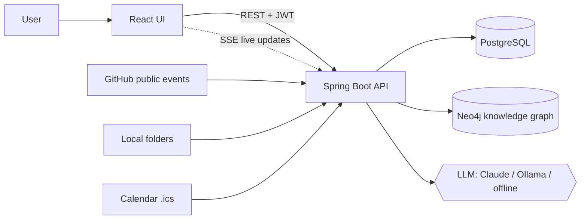
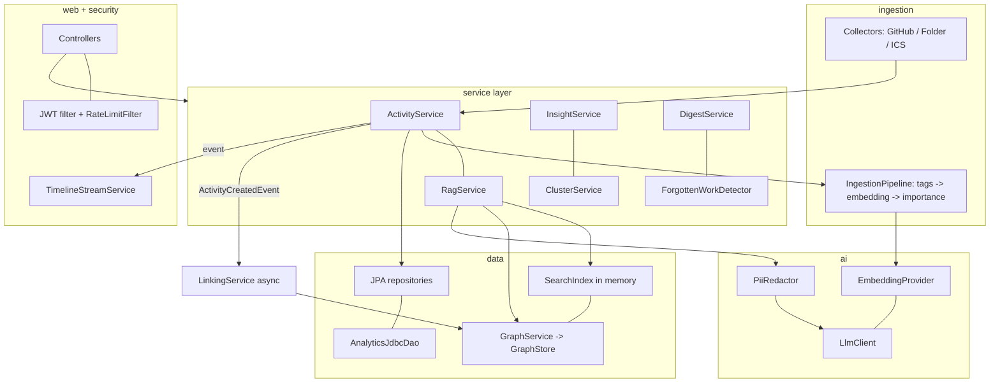
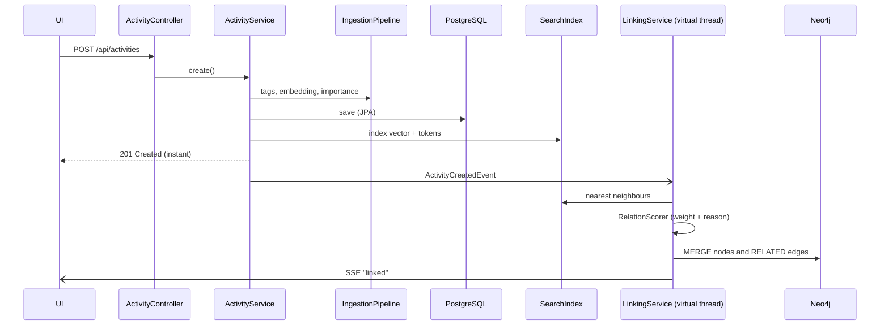
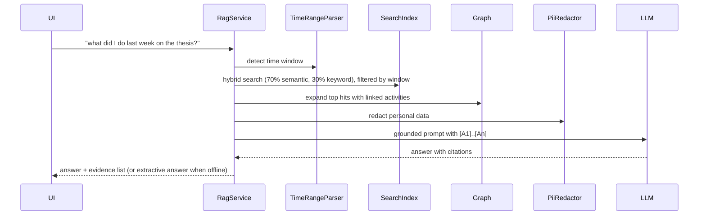
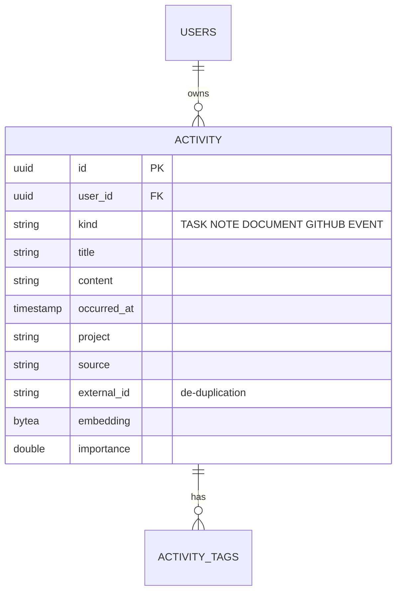
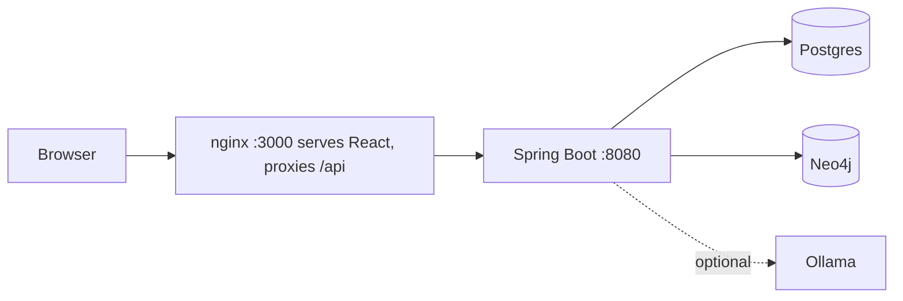

# Architecture

## 1. System context

## 2. Layered components

## 3. What happens when an activity is saved

## 4. How a question is answered (GraphRAG)

## 5. Data model

Graph in Neo4j: `(:Activity {id, userId, title, type, ts, project})-[:RELATED {kind, weight, reason}]-(:Activity)`.
`kind` is one of `SIMILAR_TO`, `SHARES_TAGS`, `SAME_PROJECT`, `FOLLOWS_UP`.

## 6. Deployment

## 7. Key design decisions
| Decision | Why |
|---|---|
| Single-table inheritance for activities | One timeline query, no joins; subtype columns are nullable. |
| Official Neo4j driver, not Spring Data Neo4j | Avoids two competing transaction managers next to JPA. |
| In-memory hybrid index first | Instant, dependency-free. For millions of rows replace `SearchIndex` with pgvector (HNSW) behind the same method signatures. |
| Graph writes are async and fault-tolerant | Saving never waits for or fails because of the graph; `GraphService` swallows and logs outages. |
| Offline mode is a first-class citizen | Demos never die on a missing key or bad Wi-Fi. |
| Embeddings stored as bytes | 4 bytes per dimension, portable across PostgreSQL and H2. |
| Activity text is untrusted | Prompts instruct the model to treat it as data; PII is stripped before leaving the machine. |

## 8. Security
BCrypt (cost 12) · stateless JWT HS256 with enforced 32-byte secret · every query scoped by `user_id` (no cross-user reads) · token bucket per user, with a stricter bucket on AI endpoints · folder collector restricted to an allow-list with `toRealPath()` (no traversal, symlinks not followed) · GitHub usernames validated by regex before building URLs · `ObjectInputFilter` on deserialization · CORS allow-list · only the SSE endpoint accepts `?access_token=`.

## 9. Scaling roadmap
pgvector + HNSW index · Flyway migrations · Redis-backed rate limits · OAuth app for private GitHub repos · Slack/Notion/Gmail collectors by adding one `ActivityCollector` subclass each · Kafka between ingestion and linking.
